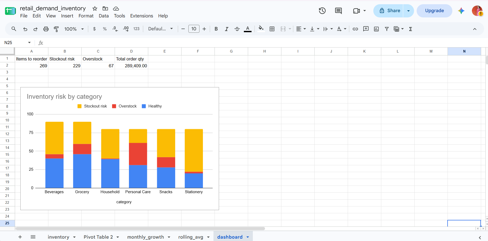

# Retail Demand Forecasting & Inventory Optimization System

A data analytics project that analyses retail sales and inventory data to forecast demand and calculate safety stock, reorder points and order quantities, helping reduce stockouts and overstock.

## Dashboard



| Items to reorder | Stockout risk | Overstock | Total order qty |
|---|---|---|---|
| 269 | 229 | 67 | 289,409 |

## Tools

- **Spreadsheet (Google Sheets / Excel):** cleaning, pivot tables, rolling average, KPI dashboard, safety stock and reorder formulas
- **SQL (PostgreSQL; SQLite notes included):** JOINs, CTEs, window functions (`LAG`, `RANK`, rolling `AVG`)

## Dataset

| Table | Key fields |
|---|---|
| Sales | date, store ID, product ID, quantity, price, promo flag |
| Inventory | product ID, store ID, current stock, reorder level, last restock date |
| Product master | name, category, cost price, selling price |
| Supplier | supplier ID, product ID, lead time (days), reliability score |

## Method

| Metric | Formula |
|---|---|
| Safety stock | `1.65 × std_dev × √lead_time` (95% service level) |
| Reorder point | `avg_daily_demand × lead_time + safety_stock` |
| Days of cover | `current_stock ÷ avg_daily_demand` |
| Status | `Reorder now` if stock < reorder point |
| Risk level | `Stockout risk`, `Overstock` or `Healthy` |

## SQL analytics

- Average daily and monthly demand
- Month-over-month growth (`LAG`)
- 7-day rolling average demand
- Top products by store and category (`RANK`)
- Promotion lift (promo vs regular days)
- Stockout periods from sales date gaps
- `v_inventory_optimization` view for reorder and risk metrics
- Optional: ABC classification, inventory turnover, supplier comparison

## Repository structure

```
.
├── README.md
├── retail_demand_inventory.sql
├── Retail_Demand_Inventory_Report.docx
├── data/
└── images/
    └── dashboard.png
```

## Key findings

- 269 items are below their reorder point, and 229 of them are at stockout risk.
- Stationery has the largest share of stockout-risk items.
- Personal Care has the highest overstock share.
- Stockout risk is a larger problem than overstock.

## Author

Kavz, final-year CSE student. [GitHub](https://github.com/kaviya-s546)
